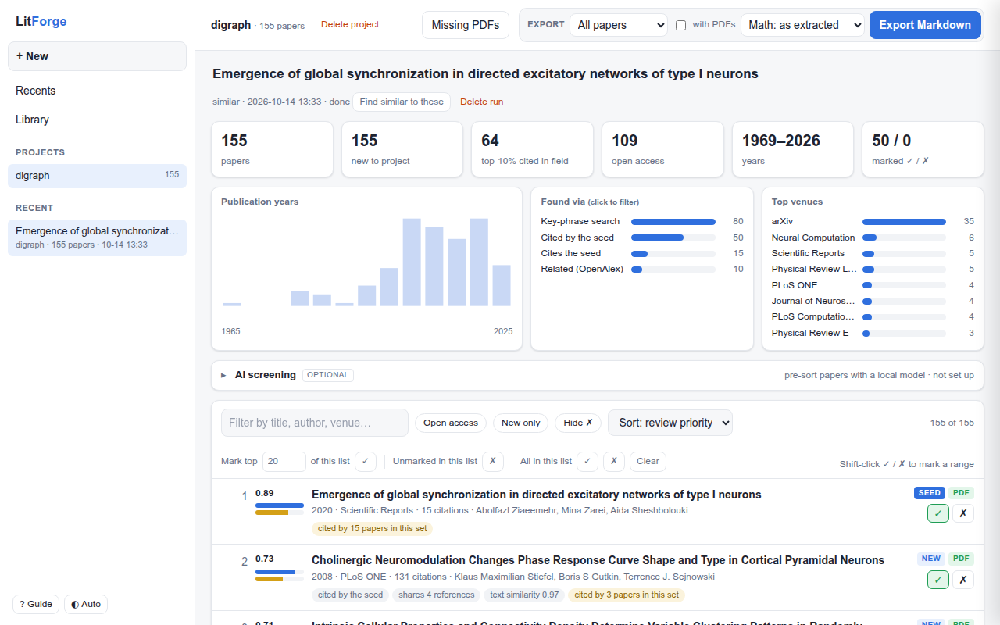
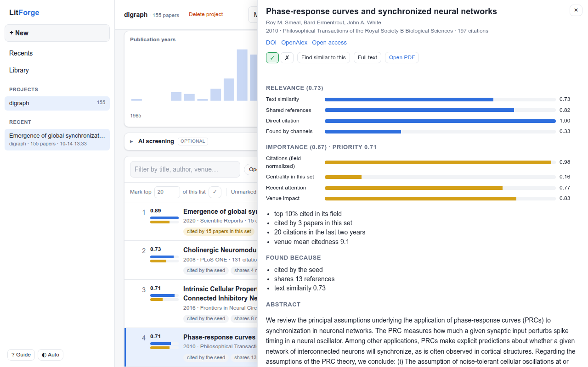
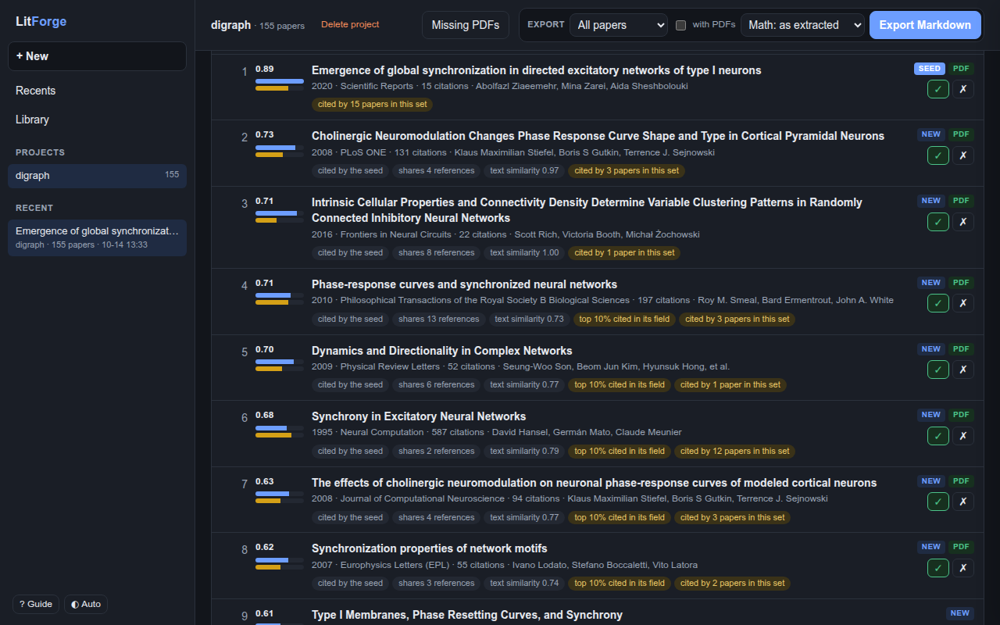

<p align="center">
  
</p>
<h1 align="center">LitForge</h1>
<p align="center">Find, screen and export scientific papers, on your own computer.<br>
<a href="docs/install.md">Install</a> · <a href="docs/guide.md">Guide</a> · <a href="#فارسی">فارسی</a></p>



LitForge turns a paper, a few keywords or a reference list into a ranked reading list, helps you
decide what to keep, and writes Markdown notes with the full text for Obsidian or a language model.
It runs in your browser, but everything stays on your machine.

## Main purpose

LitForge's main job is to build a local, structured library that a strong language model can use
cheaply. Each paper is parsed once on your computer into sections, figures, tables and equations, and
stored in a searchable database. The model then reads only what a question needs: a search returns the
matching sections with their paper and page, not the whole PDF. A full paper costs many tokens, and for
most questions most of them are not needed. Fewer tokens mean lower cost, faster answers, and more
papers fitting into one request.

```bash
litforge search "graph neural networks" --json
```

Each hit names its paper, section, page and a short quote. For the Markdown notes themselves, run
`litforge export`.

## Features

- **Find papers** from a DOI, arXiv id, PDF or abstract (references, citing papers, similar meaning),
  from keyword searches (OpenAlex, Crossref, arXiv), or from an Elicit or Zotero export.
- **Ranked by review priority**: relevance to your topic plus importance in the field, and every
  result says why it was found.
- **Mark ✓ / ✗** with the keyboard, in ranges or in bulk; "More like my ✓ papers" searches again.
- **AI screening** (optional): a local model checks titles and abstracts against your criteria.
- **PDFs**: downloads open-access copies, matches your own PDFs to their papers, lists the missing ones.
- **Markdown export** with full text, figures and equations as LaTeX.
- Light and dark themes, a quick guide (press `?`), and a command line for everything.

| Paper details | Dark theme |
|---|---|
|  |  |

## Start

Paste one line in a terminal. It installs everything and adds a **LitForge** icon to your apps:

```bash
curl -LsSf https://raw.githubusercontent.com/Ziaeemehr/LitForge/main/install.sh | sh
```

On Windows (PowerShell):

```powershell
powershell -ExecutionPolicy ByPass -c "irm https://raw.githubusercontent.com/Ziaeemehr/LitForge/main/install.ps1 | iex"
```

Then open LitForge from its icon. Closing its page stops it after about two minutes; **⏻ Quit** stops it at once.
At the end the installer offers optional tools (large downloads); **No** is the default, and you can add them later
in Settings → Optional tools.

### Update

Close LitForge, then run the same install line again. It keeps your library, settings and optional tools; the
database upgrades itself on the next start. Settings → Updates tells you when a new version is available.

More: [installation](docs/install.md) · [user guide](docs/guide.md) · [command line](docs/cli.md).

---

<div dir="rtl">

## فارسی

لیت‌فورج از یک مقاله، چند کلیدواژه یا یک فهرست منابع، فهرستی مرتب از مقاله‌های مرتبط می‌سازد، در
انتخاب مقاله‌ها کمکتان می‌کند و برای مقاله‌های انتخاب‌شده یادداشت‌های Markdown با متن کامل می‌نویسد.
در مرورگر اجرا می‌شود ولی همه‌چیز روی رایانه‌ی خودتان می‌ماند.

### هدف اصلی

هدف اصلی LitForge ساختن یک کتابخانه‌ی محلی و ساختاریافته از مقاله‌هاست که یک مدل زبانی قوی بتواند
ارزان و سریع با آن کار کند. هر مقاله یک بار روی رایانه‌ی شما خوانده می‌شود، به بخش‌ها، شکل‌ها، جدول‌ها
و معادله‌ها تبدیل می‌شود و در پایگاه داده‌ای قابل جستجو ذخیره می‌شود.

بعد از آن مدل زبانی فقط بخشی را می‌خواند که پرسش لازم دارد. جستجو بخش‌های مرتبط را همراه با نام مقاله
و شماره‌ی صفحه برمی‌گرداند، نه کل فایل PDF. ارسال یک مقاله‌ی کامل توکن زیادی مصرف می‌کند که برای بیشتر
پرسش‌ها لازم نیست. توکن کمتر یعنی هزینه‌ی کمتر، پاسخ سریع‌تر و جا شدن مقاله‌های بیشتر در یک درخواست.

</div>

```bash
litforge search "graph neural networks" --json
```

<div dir="rtl">

هر نتیجه نام مقاله، بخش، صفحه و یک نقل‌قول کوتاه را دارد. برای یادداشت‌های کامل Markdown دستور `litforge export`
را اجرا کنید.

### قابلیت‌ها

- **یافتن مقاله** از DOI، شناسه‌ی arXiv، فایل PDF یا چکیده؛ با جستجوی کلیدواژه در OpenAlex و Crossref و arXiv؛ یا از خروجی Elicit و Zotero.
- **مرتب‌سازی بر اساس اولویت مرور**: ترکیب ارتباط با موضوع و اهمیت در حوزه، همراه با دلیل یافته‌شدن هر مقاله.
- **علامت‌گذاری ✓ و ✗** با صفحه‌کلید، به‌صورت بازه‌ای یا گروهی، و جستجوی دوباره از مقاله‌های ✓.
- **غربالگری با هوش مصنوعی** (اختیاری): یک مدل محلی عنوان و چکیده را با معیارهای شما می‌سنجد.
- **مدیریت PDF**: دریافت نسخه‌های دسترسی آزاد، تطبیق PDFهای خودتان و فهرست PDFهای ناموجود.
- **خروجی Markdown** با متن کامل، شکل‌ها و معادله‌ها به LaTeX.
- پوسته‌ی روشن و تاریک، راهنمای سریع (کلید `?`) و خط فرمان برای همه‌ی کارها.

### شروع

این یک خط را در ترمینال اجرا کنید. همه‌چیز نصب می‌شود و آیکون LitForge به برنامه‌هایتان اضافه می‌شود:

</div>

```bash
curl -LsSf https://raw.githubusercontent.com/Ziaeemehr/LitForge/main/install.sh | sh
```

<div dir="rtl">

در ویندوز، همین کار در PowerShell:

</div>

```powershell
powershell -ExecutionPolicy ByPass -c "irm https://raw.githubusercontent.com/Ziaeemehr/LitForge/main/install.ps1 | iex"
```

<div dir="rtl">

از این به بعد LitForge را با آیکونش باز کنید و با دکمه‌ی **⏻ Quit** در صفحه ببندید، یا فقط صفحه را ببندید؛ حدود دو دقیقه بعد خودش بسته می‌شود.

### به‌روزرسانی

LitForge را ببندید و همان خط نصب را دوباره اجرا کنید. کتابخانه، تنظیمات و ابزارهای اختیاری حفظ می‌شوند و پایگاه داده
در اجرای بعدی خودش به‌روز می‌شود. بخش «Updates» در تنظیمات خبر می‌دهد که نسخه‌ی تازه آمده است.

بیشتر: [نصب](docs/install.md) · [راهنما](docs/guide.md) · [خط فرمان](docs/cli.md).

</div>

## License note

PyMuPDF is AGPL-licensed. Review this before distributing LitForge or derived work.
