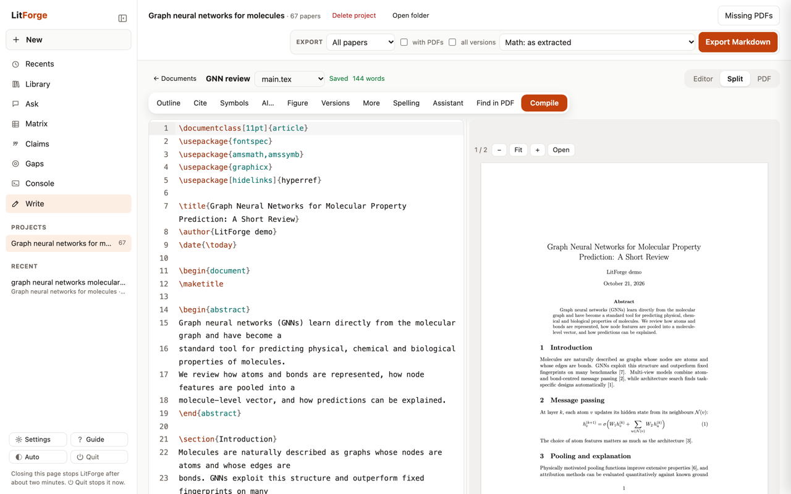
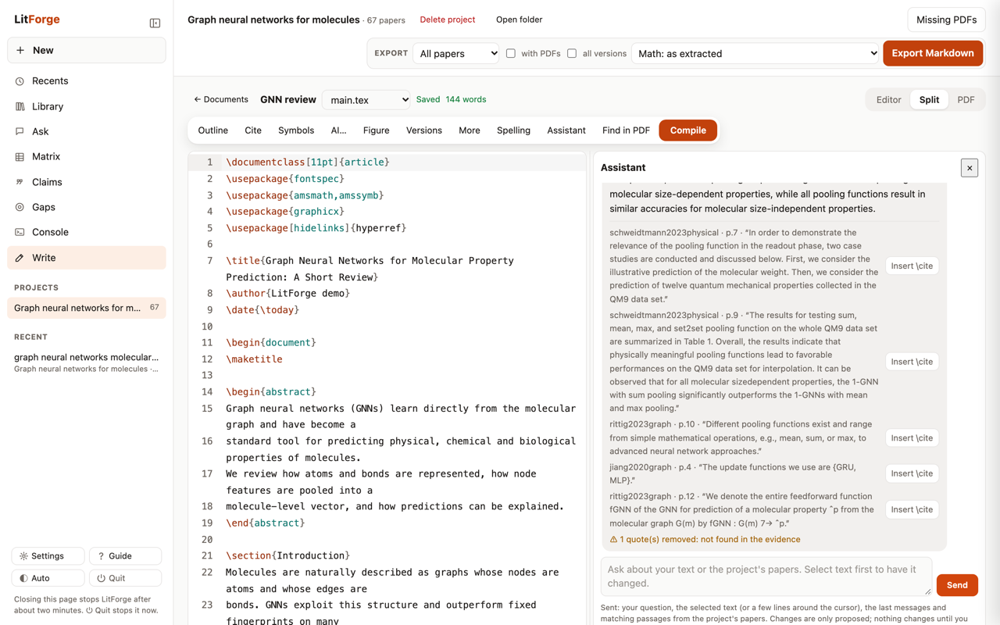

<p align="center">
  
</p>
<h1 align="center">LitForge</h1>
<p align="center">Find, screen and export scientific papers, on your own computer.<br>
<a href="docs/install.md">Install</a> · <a href="docs/guide.md">Guide</a> · <a href="#فارسی">فارسی</a></p>


LitForge turns a paper, a few keywords or a reference list into a ranked reading list, helps you
decide what to keep, answers questions from the papers with verified quotes, and lets you write your
own paper in LaTeX next to them. It runs in its own window, and everything stays on your machine.

## Main purpose

LitForge's main job is to build a local, structured library that a strong language model can use
cheaply. Each paper is parsed once on your computer into sections, figures, tables and equations, and
stored in a searchable database. The model then reads only what a question needs: a search returns the
matching sections with their paper and page, not the whole PDF. A full paper costs many tokens, and for
most questions most of them are not needed. Fewer tokens mean lower cost, faster answers, and more
papers fitting into one request.

```bash
litforge search "graph neural networks" --json
```

Each hit names its paper, section, page and a short quote. For the Markdown notes themselves, run
`litforge export`.

## Features

- **Find papers** from a DOI, arXiv id, PDF or abstract (references, citing papers, similar meaning),
  from keyword searches (OpenAlex, Crossref, arXiv), or from an Elicit or Zotero export.
- **Ranked by review priority**: relevance to your topic plus importance in the field, and every
  result says why it was found.
- **Mark ✓ / ✗** with the keyboard, in ranges or in bulk; "More like my ✓ papers" searches again.
- **AI screening** (optional): a local model checks titles and abstracts against your criteria.
- **Sources**: downloads open-access PDFs, adds papers from links, and reads your own PDFs and Word,
  PowerPoint, Excel, HTML, EPUB and Markdown files.
- **Ask** the project: answers cite the page, and every quote is checked against the paper.
- **Writing Studio**: a LaTeX editor with live PDF preview, citations from your library (BibTeX kept in
  sync), spell check, versions and git sync (Overleaf, GitHub). AI actions fix errors, rewrite, translate
  (English ↔ Persian), suggest citations, a title or an abstract, and turn an image into an equation or a
  table; nothing changes until you accept. An assistant beside the editor answers from your papers.
- **Models, one choice**: Local (free, nothing leaves your computer), Cloud, Hybrid or Manual.
- **Markdown export** with full text, figures and equations as LaTeX.
- Light and dark themes, a quick guide (press `?`), and a command line for everything.

| Writing Studio | Assistant with verified quotes |
|---|---|
|  |  |
| **Paper details** | **Dark theme** |
|  |  |

## Start

The installer keeps the program in your platform’s app-data folder and asks where your library lives; see [installation and library locations](docs/install.md).

Paste one line in a terminal. It installs everything and adds a **LitForge** icon to your apps:

```bash
curl -LsSf https://raw.githubusercontent.com/Ziaeemehr/LitForge/main/install.sh | sh
```

On Windows (PowerShell):

```powershell
powershell -ExecutionPolicy ByPass -c "irm https://raw.githubusercontent.com/Ziaeemehr/LitForge/main/install.ps1 | iex"
```

Then open LitForge from its icon: it opens in its own window. Closing the window (or **⏻ Quit**) stops it, after
saving your open file.
The installer also adds Tectonic (~22 MB), the LaTeX engine of the Writing Studio.
At the end it offers optional tools (large downloads); **No** is the default, and you can add them later
in Settings → Optional tools.

### Update

Close LitForge, then run the same install line again. It keeps your library, settings and optional tools; the
database upgrades itself on the next start. Settings → Updates tells you when a new version is available.

More: [installation](docs/install.md) · [user guide](docs/guide.md) · [command line](docs/cli.md).

---

<div dir="rtl">

## فارسی

لیت‌فورج از یک مقاله، چند کلیدواژه یا یک فهرست منابع، فهرستی مرتب از مقاله‌های مرتبط می‌سازد، در
انتخاب مقاله‌ها کمکتان می‌کند و برای مقاله‌های انتخاب‌شده یادداشت‌های Markdown با متن کامل می‌نویسد.
در مرورگر اجرا می‌شود ولی همه‌چیز روی رایانه‌ی خودتان می‌ماند.

### هدف اصلی

هدف اصلی LitForge ساختن یک کتابخانه‌ی محلی و ساختاریافته از مقاله‌هاست که یک مدل زبانی قوی بتواند
ارزان و سریع با آن کار کند. هر مقاله یک بار روی رایانه‌ی شما خوانده می‌شود، به بخش‌ها، شکل‌ها، جدول‌ها
و معادله‌ها تبدیل می‌شود و در پایگاه داده‌ای قابل جستجو ذخیره می‌شود.

بعد از آن مدل زبانی فقط بخشی را می‌خواند که پرسش لازم دارد. جستجو بخش‌های مرتبط را همراه با نام مقاله
و شماره‌ی صفحه برمی‌گرداند، نه کل فایل PDF. ارسال یک مقاله‌ی کامل توکن زیادی مصرف می‌کند که برای بیشتر
پرسش‌ها لازم نیست. توکن کمتر یعنی هزینه‌ی کمتر، پاسخ سریع‌تر و جا شدن مقاله‌های بیشتر در یک درخواست.

</div>

```bash
litforge search "graph neural networks" --json
```

<div dir="rtl">

هر نتیجه نام مقاله، بخش، صفحه و یک نقل‌قول کوتاه را دارد. برای یادداشت‌های کامل Markdown دستور `litforge export`
را اجرا کنید.

### قابلیت‌ها

- **یافتن مقاله** از DOI، شناسه‌ی arXiv، فایل PDF یا چکیده؛ با جستجوی کلیدواژه در OpenAlex و Crossref و arXiv؛ یا از خروجی Elicit و Zotero.
- **مرتب‌سازی بر اساس اولویت مرور**: ترکیب ارتباط با موضوع و اهمیت در حوزه، همراه با دلیل یافته‌شدن هر مقاله.
- **علامت‌گذاری ✓ و ✗** با صفحه‌کلید، به‌صورت بازه‌ای یا گروهی، و جستجوی دوباره از مقاله‌های ✓.
- **غربالگری با هوش مصنوعی** (اختیاری): یک مدل محلی عنوان و چکیده را با معیارهای شما می‌سنجد.
- **منابع**: دریافت PDFهای دسترسی آزاد، افزودن مقاله از لینک، و خواندن PDF و فایل‌های Word، PowerPoint، Excel، HTML، EPUB و Markdown خودتان.
- **پرسش از پروژه**: پاسخ‌ها صفحه‌ی منبع را می‌آورند و هر نقل‌قول با متن مقاله بررسی می‌شود.
- **استودیوی نوشتن**: ویرایشگر LaTeX با پیش‌نمایش زنده‌ی PDF، ارجاع از کتابخانه، غلط‌یاب، نسخه‌ها و همگام‌سازی با git (Overleaf، GitHub). کارهای هوش مصنوعی: رفع خطا، بازنویسی، ترجمه‌ی انگلیسی و فارسی، پیشنهاد ارجاع، عنوان و چکیده، و تبدیل تصویر به معادله یا جدول؛ تا تأیید نکنید چیزی تغییر نمی‌کند. دستیار کنار ویرایشگر از روی مقاله‌هایتان پاسخ می‌دهد.
- **مدل‌ها با یک انتخاب**: محلی (رایگان، بدون خروج داده)، ابری، ترکیبی یا دستی.
- **خروجی Markdown** با متن کامل، شکل‌ها و معادله‌ها به LaTeX.
- پوسته‌ی روشن و تاریک، راهنمای سریع (کلید `?`) و خط فرمان برای همه‌ی کارها.

### شروع

این یک خط را در ترمینال اجرا کنید. همه‌چیز نصب می‌شود و آیکون LitForge به برنامه‌هایتان اضافه می‌شود:

</div>

```bash
curl -LsSf https://raw.githubusercontent.com/Ziaeemehr/LitForge/main/install.sh | sh
```

<div dir="rtl">

در ویندوز، همین کار در PowerShell:

</div>

```powershell
powershell -ExecutionPolicy ByPass -c "irm https://raw.githubusercontent.com/Ziaeemehr/LitForge/main/install.ps1 | iex"
```

<div dir="rtl">

از این به بعد LitForge را با آیکونش باز کنید؛ در پنجره‌ی خودش باز می‌شود. با بستن پنجره یا دکمه‌ی **⏻ Quit** بسته می‌شود و پیش از آن فایل باز شما ذخیره می‌شود.

### به‌روزرسانی

LitForge را ببندید و همان خط نصب را دوباره اجرا کنید. کتابخانه، تنظیمات و ابزارهای اختیاری حفظ می‌شوند و پایگاه داده
در اجرای بعدی خودش به‌روز می‌شود. بخش «Updates» در تنظیمات خبر می‌دهد که نسخه‌ی تازه آمده است.

بیشتر: [نصب](docs/install.md) · [راهنما](docs/guide.md) · [خط فرمان](docs/cli.md).

</div>

## License

LitForge is free software under the [GNU Affero General Public License v3.0](LICENSE) (AGPL-3.0). You may use, change and share it; if you distribute it, or offer a changed version to others over a network, you must make its source available under the same license. It depends on PyMuPDF, which is AGPL-licensed too.

If LitForge is useful to you, you can support its development through [GitHub Sponsors](https://github.com/sponsors/Ziaeemehr).
