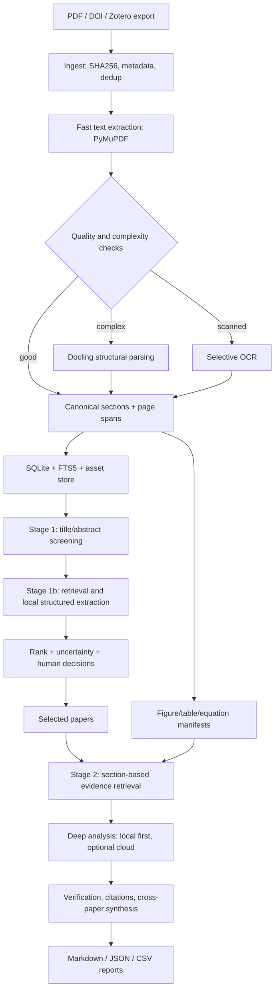

# Local-first Scientific Literature Analysis System

**Implementation blueprint — v1.0 | 2026-10-14**

## 0. Mission and constraints

Build a reproducible, local-first system that (A) screens hundreds or thousands of research papers and (B) performs evidence-grounded deep analysis on selected papers. Primary machine: NVIDIA RTX 5070 with **12 GB VRAM**. Use deterministic extraction and small local language models for high-volume work; reserve Codex, Claude Code, or optional remote reasoning/vision models for complex synthesis and engineering tasks.

**Non-negotiables:** never discard original PDFs; parse once and cache; keep page-level provenance; never fabricate citations; distinguish extracted facts from model interpretations; allow human review; log token use, time, and cost; keep cloud upload opt-in; never silently OCR all pages or send all figures to a model.

**Scope:** scientific PDFs (particularly computational neuroscience, EEG/MEG/fMRI, neural mass models, SBI). MVP is a CLI and local SQLite store, not a complicated web platform.

## 1. End-to-end architecture



Two distinct caches: **parse cache** keyed by PDF SHA256 + parser config/version, and **analysis cache** keyed by paper ID + content hash + prompt/schema/model/version + screening question. Changes to research questions must not require PDF re-parsing.

## 2. Stack and hardware policy

| Component | MVP | Upgrade path | Notes |
|---|---|---|---|
| Runtime | Python 3.11/3.12, `uv` | Docker | Lock versions; verify CUDA/driver |
| PDF triage | PyMuPDF | — | Page count, text blocks, bbox, page previews |
| Complex PDF | Docling | Marker as benchmark | Markdown + structured JSON; table/layout extraction |
| OCR | Docling OCR selectively | alternate OCR engine | Only when needed; record OCR confidence |
| Storage | SQLite + JSON files | PostgreSQL | SQLite WAL, migrations, foreign keys |
| Lexical retrieval | SQLite FTS5 (BM25) | OpenSearch | Excellent for named models/equations |
| Embeddings | small local sentence-transformer | larger embedding model | Benchmark domain-specific retrieval |
| Vector search | FAISS CPU | Qdrant | FAISS index must be reconstructible |
| Local LLM | Ollama or llama.cpp | vLLM if warranted | Quantized ~3–8B text models; test VRAM |
| Optional local vision | compact quantized VLM | cloud vision | Run sequentially, not concurrently with text LLM |
| API | Typer CLI | FastAPI | Keep core pipeline UI-independent |
| Tests | pytest + golden PDFs | CI | Include complex multi-column figures/tables |
| Logging | structured JSONL | OpenTelemetry | Token/latency/cache/error metrics |

**VRAM:** 12 GB is a hard operational budget, not a promise that every 8B or VLM will fit. Quantization, context length, KV cache, model architecture and parser GPU use affect peak memory. Start with a **4B-class instruct model, Q4** for high-volume structured extraction; benchmark an **8B-class Q4** candidate for harder screening. Choose exact current model IDs only after validating availability, license, structured JSON support and local benchmarks. Embeddings should run on CPU initially to avoid VRAM contention. Run Docling GPU processing and LLM inference sequentially. Target <10.5 GB measured peak VRAM as a safety margin; reduce context, batch, or model size if exceeded. Use `nvidia-smi` to monitor.

**Why not LLM for basic parsing?** Native PDF text extraction is deterministic, faster and token-free. Local LLM is for classification, structured interpretation and short evidence-grounded extraction, not for reading every page pixel-by-pixel.

## 3. Repository layout

```text
literature-lab/
  README.md
  pyproject.toml
  uv.lock
  .env.example
  configs/
    default.yaml
    models.yaml
    screening_rubric.yaml
  src/litlab/
    cli.py
    config.py
    ingest.py
    pdf/triage.py
    pdf/pymupdf_parser.py
    pdf/docling_parser.py
    pdf/quality.py
    pdf/assets.py
    metadata/resolve.py
    storage/db.py
    storage/migrations/
    retrieval/chunk.py
    retrieval/fts.py
    retrieval/vector.py
    retrieval/hybrid.py
    llm/local.py
    llm/schemas.py
    llm/prompts.py
    screening/stage1.py
    screening/stage1b.py
    screening/ranking.py
    deep/plan.py
    deep/extract.py
    deep/verify.py
    deep/synthesis.py
    export/markdown.py
    export/csv.py
    observability.py
  tests/fixtures/
  tests/unit/
  tests/integration/
  data/                  # gitignored
    originals/
    parsed/
    assets/
    indexes/
    reports/
    logs/
```

## 4. Ingestion, deduplication and metadata

1. Import PDF(s) from directory; optional DOI/BibTeX/Zotero integration later.
2. Calculate SHA256 of PDF bytes; skip identical copies; preserve filenames as aliases.
3. Extract DOI from metadata/text with validation; avoid treating uncertain matches as verified.
4. Capture title, authors, year, journal, DOI, abstract, provenance and parsing status. Metadata may be missing; use `null` and a confidence/status flag rather than guesses.
5. Assign stable `paper_id` (UUID), store content hash, original path and timestamps.
6. Detect near-duplicates using DOI, normalized title/year and manual confirmation; retain versions/preprints as separate artifacts linked to a conceptual work.
7. Quarantine corrupt/encrypted files; log actionable errors.

## 5. Parsing: fast path, fallback and QA

### 5.1 Fast path

Use PyMuPDF for per-page `text`, `blocks`, bounding boxes, page count and text density. Preserve source page numbers (PDF page index **and** printed page label if available). Do not assume raw PDF block order equals reading order, especially in two-column papers.

### 5.2 Routing rules (initial heuristics; calibrate)

- **Native text-rich, simple layout:** PyMuPDF, with reading-order sanity checks.
- **Two-column, many equations/tables or garbled order:** Docling structured parse.
- **Image-only or text-sparse pages:** OCR *only on affected pages*, after checking for genuinely blank/figure-only pages.
- **Failed parse:** retry alternate parser; mark `needs_review`, never treat empty output as a valid paper.

Use measurable quality signals: extracted characters/page, Unicode replacement rate, repeated headers, section detection, references detection, suspicious line fragmentation, page-order anomalies, table counts. Record parser decision and quality metrics. Thresholds should be tuned on a labeled benchmark rather than asserted as universal.

### 5.3 Canonical representation

Store (a) original PDF, (b) canonical JSON with document hierarchy and page/bbox provenance, (c) readable Markdown, (d) asset manifests. Each paragraph/chunk has `paper_id`, `section_path`, `page_start`, `page_end`, `bbox_refs`, `text`, `parser`, `quality_flags`. Keep footnotes, captions, references and supplementary material labeled separately.

### 5.4 Figures, tables, equations

- Figures: store extracted image or **cropped page region**, caption, label, page and bounding box. Native embedded images may not equal a complete scientific figure assembled from vector objects; page crops are the robust fallback.
- Tables: structured rows/cells plus HTML or Markdown; keep caption, footnotes, units and original page crop. Do not flatten multi-level headers without retaining header hierarchy.
- Equations: preserve raw text and, when available, LaTeX plus page crop. Never silently trust OCR of Greek symbols, indices or signs.
- At screening stage, do **not** run vision over every figure. Use figure captions and route only question-relevant images to vision in deep analysis.
- Add `asset_quality=verified|uncertain|failed` and review flags for critical numerical evidence.

## 6. Indexing and retrieval

Chunk by **sections and paragraph boundaries**, not fixed page count. Initial target: 400–800 tokens/chunk with 60–100 overlap where necessary; preserve full paragraphs and references. Attach section, page, paper ID, caption/equation flags. Avoid indexing bibliographies as ordinary research evidence by default.

Implement lexical BM25/FTS5 first. Add local embeddings and FAISS for semantic retrieval. Hybrid ranking via reciprocal rank fusion (RRF) or calibrated weighted fusion. Deduplicate near-identical chunks and diversify across sections. For cross-paper questions, cap chunks per paper to prevent long papers dominating results. Always return quoted evidence snippets and page references, not just scores.

**Evaluation:** manually annotate at least 30 questions and relevant evidence chunks; measure Recall@5/10, MRR, page-citation accuracy and latency. Compare lexical-only vs vector-only vs hybrid; keep the simpler solution if the upgrade provides no measurable gain.

## 7. Stage 1 — high-volume screening

### 7.1 Input

Research question + inclusion/exclusion criteria + rubric version. Each screening run is a reproducible `project` with its own scope, prompts, decisions and rankings.

### 7.2 Cascaded workflow

**Tier A (cheap):** title, abstract, keywords. Local model returns structured JSON: `relevance`, `decision` (`include|exclude|uncertain`), `reasons`, `evidence_quotes`, `missing_information`, `confidence`. Exclude only if criteria are explicitly violated; missing abstract is not a negative result.

**Tier B (targeted):** for include/uncertain, retrieve Introduction/Methods/Results/Conclusion chunks relevant to the question. Re-score against the rubric with source quotes and page references.

**Tier C (human review):** borderline papers, conflicting signals, missing metadata, and high-impact candidate papers. Never let a single opaque score automatically discard potentially important work.

### 7.3 Example weighted rubric (configurable)

| Criterion | Weight |
|---|---:|
| Topic / hypothesis relevance | 0.30 |
| Methodological overlap | 0.25 |
| Data/modality relevance | 0.15 |
| Evidence/results relevance | 0.15 |
| Reproducibility and methodological clarity | 0.10 |
| Novelty or complementarity | 0.05 |

Scores are 0–5 per criterion; compute weighted total deterministically in Python, not in LLM free text. Missing evidence means `not_assessed`, not zero. Maintain separate `evidence_quality` and `uncertainty` fields. Do not use a numerical confidence value as a calibrated probability unless calibration has been demonstrated.

### 7.4 Domain-specific extraction schema

Optional fields: `neural_model` (Jansen–Rit, Wilson–Cowan, Wong–Wang, VEP, etc.), `inference_method` (SBI, likelihood-based, variational, MCMC), `observed_modality` (EEG/MEG/fMRI), `simulation_model`, `estimated_parameters`, `features`, `validation_metrics`, `code_availability`, `dataset_availability`, `limitations`. Each populated field should include evidence references. Distinguish “not reported” from “not extracted.”

### 7.5 Batch control

Bound concurrency (start 1 GPU model request at a time), use short prompts and limited retrieved context, strict JSON schema, retries with backoff and a repair attempt, idempotent jobs, checkpoints and resumability. Track throughput (papers/min), invalid JSON rate, context size, total tokens and estimated cost. No automatic cloud fallback.

## 8. Stage 2 — selected-paper deep analysis

### 8.1 Analysis plan

For each selected paper generate a checklist of questions: research hypothesis; assumptions; mathematical model and equations; parameters/units; simulation/experimental data; preprocessing; inference objective; training/validation split; uncertainty quantification; numerical results; baselines; ablations; limitations; reproducibility; relevance to research project.

### 8.2 Evidence gathering

Retrieve **all relevant sections**, not arbitrary top-k snippets. Inspect captions, tables, equations and selected figure crops. Keep a coverage map showing which paper sections were examined. For critical claims, cite exact page and preferably bbox/section. Store verbatim short evidence snippets internally; exported quotations should respect applicable copyright rules.

### 8.3 Model routing

- Local small text model: structured field extraction, section summaries, terminology normalization, straightforward comparisons.
- Stronger local model (if benchmarked): difficult but text-only synthesis.
- Codex/Claude Code: implement and debug the pipeline, build evaluation harnesses, run reproducible code-based checks, write analyses from supplied evidence; they are **not** a replacement for provenance or verification.
- Optional remote reasoning/vision: complex figure interpretation, mathematical critique and multi-paper synthesis **only with explicit consent**, selected evidence and privacy checks. Maintain provider-agnostic adapters and record exactly what was transmitted.

### 8.4 Output for one paper

`paper_analysis.md` contains citation and metadata, 150–300 word executive summary, structured method review, mathematical assumptions, key findings with figure/table references, methodological limitations, reproducibility checklist, unanswered questions, relevance score and exact evidence appendix. Mark all inferences as `interpretation` rather than author-stated facts.

### 8.5 Cross-paper synthesis

Build a normalized comparison matrix (model, data, inference, parameterization, metrics, validation, limitations) and narrative synthesis with per-claim paper/page citations. Identify disagreements and possible causes (datasets, preprocessing, assumptions) without asserting causality without evidence. Include a “missing evidence” section and a conflict-resolution review queue.

## 9. Database model

Core SQLite tables:

```text
papers(id, title, doi, year, metadata_json, created_at)
artifacts(id, paper_id, sha256, pdf_path, version_label)
parse_runs(id, artifact_id, parser, parser_version, config_hash, status, quality_json)
sections(id, parse_run_id, parent_id, heading, order_idx, page_start, page_end)
chunks(id, section_id, text, token_count, page_start, page_end, bbox_json, hash)
assets(id, parse_run_id, kind, label, caption, page, bbox_json, path, quality)
projects(id, name, research_question, criteria_json, rubric_version)
screening_runs(id, project_id, model_id, prompt_hash, status, started_at)
screening_results(id, run_id, paper_id, decision, scores_json, rationale_json)
evidence(id, paper_id, chunk_id, asset_id, page, quote, claim_id)
review_decisions(id, project_id, paper_id, reviewer, decision, notes, timestamp)
deep_runs(id, project_id, paper_id, model_id, prompt_hash, report_path, status)
llm_calls(id, run_id, provider, model_id, input_tokens, output_tokens, latency_ms, cost, status)
```

Add indexes on foreign keys, DOI, hashes and project IDs; FTS5 virtual table for chunks; use migration scripts. `evidence` must point to a chunk or asset and a verifiable source location. Ensure cascade behavior is explicit and raw PDFs are never deleted by routine DB cleanup.

## 10. LLM output contracts

Use Pydantic schemas and JSON-schema constrained output where supported. Example:

```json
{
  "decision": "uncertain",
  "criteria": [{"name":"method_overlap","score":4,"status":"assessed"}],
  "facts": [{"claim":"Uses a neural mass model", "evidence_ids":["chunk_001"]}],
  "missing_information": ["Validation cohort not found"],
  "interpretation": "Potentially relevant to model inversion"
}
```

Validate enum values, allowed score range, evidence IDs, JSON parseability and citation existence. Reject hallucinated references. A valid JSON object is **not** proof that the claims are correct: add evidence entailment spot checks and human audit.

**Prompt design:** short system instruction, explicit research criteria, exact schema, retrieved evidence with stable IDs, prohibition on outside unsupported claims, and `unknown`/`not_assessed` escape hatches. Resist prompt injection from PDF text by treating all document content as untrusted data.

## 11. Evaluation and acceptance criteria

Create a 40–60 PDF benchmark: simple born-digital, two-column, scanned, formula-heavy, table-heavy, figures, supplementary appendices, corrupted/duplicate files. Hand-label 20–30 screening decisions and 30–50 evidence claims. Suggested *initial project targets* (not promises):

- 100% original PDF preservation and deterministic SHA256 dedup.
- >95% parse-job completion on supported, noncorrupt PDFs; failures explicitly surfaced.
- >95% schema-valid local LLM outputs after bounded retry.
- ≥90% citation pointers resolve to a stored page/chunk/asset; aim for 100% in released reports.
- ≥90% recall of human-labeled relevant papers at the *shortlist* stage; tune thresholds for recall rather than precision.
- Measure false-negative screening rate, evidence correctness, table-cell fidelity, equation symbol fidelity, figure-caption association and time/paper.
- Benchmark peak VRAM and batch throughput on actual RTX 5070; no assumed performance numbers.

Run regression tests on every parser/model/prompt upgrade. Maintain an immutable screening result per version and compare diffs before replacing rankings.

## 12. Security, reproducibility, and cost

- Keep PDFs and derived assets local by default; explicit cloud opt-in at job level.
- PDF/Markdown content is untrusted: do not execute embedded scripts, shell commands or external links automatically.
- Restrict filesystem paths, subprocesses, upload destinations and network permissions.
- Log software/model versions, quantization, context settings, prompts, seeds when available, parser configs and PDF hashes.
- Use a model license review before distribution/commercial use.
- Never hard-code API keys; `.env` excluded from Git.
- Token budgeting: set max input chunks and max output tokens per task; report real usage when available, estimate otherwise. Separate local compute/electricity costs from API token charges.
- Backup SQLite + original PDFs + parsed JSON; FAISS can be regenerated.

## 13. Implementation roadmap and agent-ready tickets

### Phase 0 — Baseline and benchmarks (1–2 days)
- [ ] Confirm OS, NVIDIA driver, CUDA compatibility, 12 GB VRAM, RAM and storage.
- [ ] Initialize `uv`, repository, pytest, ruff, mypy/pyright, pre-commit.
- [ ] Assemble 40–60 representative PDFs and label quality cases.
- [ ] Benchmark PyMuPDF and Docling on 10 documents (CPU/GPU time, accuracy).
- [ ] Benchmark one 4B Q4 and one 8B Q4 model on JSON extraction, latency and peak VRAM.
**Done when:** benchmark CSV and baseline report exist; no model choice based solely on size.

### Phase 1 — Ingestion and parsing (3–5 days)
- [ ] `ingest` CLI with hashes, metadata, duplicate detection and safe failure handling.
- [ ] PyMuPDF fast parser and complexity/quality router.
- [ ] Docling fallback, selective OCR, Markdown and canonical JSON export.
- [ ] Figures/tables/equations manifest with page/bbox mapping.
- [ ] SQLite schema, migrations, caching and 20 integration tests.
**Done when:** 50 PDFs can be processed, resumed and traced back to original pages.

### Phase 2 — Retrieval (2–3 days)
- [ ] Section-aware chunker with stable IDs and tokenizer measurement.
- [ ] FTS5 lexical search with page-aware results.
- [ ] Optional embedding index + hybrid retrieval + evaluation script.
**Done when:** benchmark questions retrieve source-grounded passages with measured Recall@k.

### Phase 3 — Screening (3–5 days)
- [ ] Versioned research project/rubric configuration.
- [ ] Local Ollama adapter with structured output and Pydantic validation.
- [ ] Tier A/Tier B cascade, scoring, uncertainties, checkpoints.
- [ ] Human decision overrides and shortlist CSV/Markdown export.
- [ ] 100–500 paper end-to-end dry run; report throughput, token usage and false negatives.
**Done when:** screening is resumable, auditable, and preserves uncertain candidates.

### Phase 4 — Deep analysis (4–6 days)
- [ ] Paper analysis plan + section coverage tracking.
- [ ] Figure/table/equation on-demand loading.
- [ ] Evidence claim verification and page-linked reports.
- [ ] Optional cloud provider adapter behind explicit consent.
- [ ] Cross-paper comparison matrix and synthesis.
**Done when:** 5 selected papers yield reports whose central claims can be checked against original PDF pages.

### Phase 5 — UI and integrations (optional)
- [ ] Streamlit or lightweight FastAPI UI: import, progress, rubric, review queue, search, evidence viewer.
- [ ] Zotero/BibTeX integration; DOI metadata resolver.
- [ ] Export Obsidian-compatible Markdown with local asset links.
- [ ] Incremental updates when new papers are added.

## 14. CLI contract (target interface, not implemented yet)

```bash
uv run litlab doctor
uv run litlab ingest ./papers --project neuro-sbi
uv run litlab parse --project neuro-sbi --workers 2
uv run litlab index --project neuro-sbi --mode lexical
uv run litlab screen --project neuro-sbi --rubric configs/screening_rubric.yaml --model local-small
uv run litlab shortlist --project neuro-sbi --top 30 --include-uncertain
uv run litlab analyze --project neuro-sbi --paper-id PAPER_ID --mode deep
uv run litlab synthesize --project neuro-sbi --selected reviewed
uv run litlab export --project neuro-sbi --format markdown,csv,json
uv run litlab benchmark --suite tests/fixtures
```

`doctor` verifies GPU, Ollama endpoint, models, parser installations, disk space, DB migrations and write permissions. Commands should support `--dry-run`, `--resume`, `--force`, `--json` where relevant.

## 15. Example project configuration

```yaml
project: neuro-sbi
question: "Which studies infer neural mass model parameters from EEG/MEG using SBI or related inverse methods?"
include:
  - computational neural population models
  - parameter inference or inversion
exclude:
  - unrelated clinical case reports without modeling
screening:
  stage_a: {model: local-small, max_output_tokens: 450}
  stage_b: {model: local-small, max_evidence_chunks: 8, max_output_tokens: 800}
  exclude_policy: explicit_criterion_violation_only
  preserve_uncertain: true
parsing:
  fast_path: pymupdf
  complex_fallback: docling
  ocr: selective
  keep_originals: true
retrieval:
  lexical: true
  semantic: false  # enable after evaluation
  chunk_target_tokens: 600
  chunk_overlap_tokens: 80
privacy:
  allow_cloud: false
```

## 16. Prompts for coding agents

### Codex — implementation lead

> Implement Phase 1 of `literature_analysis_architecture_plan.md` in a new Python `uv` project. Begin by creating a short design note and tests, then implement CLI ingestion, SHA256 deduplication, SQLite migrations, PyMuPDF fast-path extraction, Docling fallback, canonical JSON/Markdown, source-page provenance, and resumable cache. Do not implement future phases yet. Do not upload PDFs. Use type hints, structured logging, pytest, and small commits. Demonstrate on synthetic and permitted sample PDFs. Report benchmark results and remaining risks.

### Claude Code — review and scientific QA

> Audit the Phase 1 implementation against the architecture plan. Focus on two-column reading order, scientific equations, composite vector figures, table headers, page/bbox provenance, cache invalidation, failure recovery, security, and false confidence in extracted content. Write failing regression tests for discovered defects before proposing fixes. Do not claim extraction fidelity without inspecting the original PDFs.

### Codex — screening stage

> Implement Phase 3 only after Phase 1–2 acceptance tests pass. Add local LLM structured-output adapters, versioned rubrics, evidence-backed scoring, uncertainty retention, resume/checkpoint behavior, human override, and CSV/Markdown reports. Include an evaluation harness measuring recall of relevant papers and false negatives. Optimize for screening recall, not simply maximum exclusion rate.

### Claude Code — deep analysis stage

> Implement Phase 4 using evidence-grounded retrieval and per-claim page references. Make figure/table/equation vision optional and on-demand. Build a five-paper cross-study comparison and flag unsupported or contradictory claims. Preserve a traceable record of all source excerpts and model prompts. No external API calls without explicit configuration.

## 17. Key engineering decisions to defer until benchmarks

1. Exact small-model family and quantization (depends on observed RTX 5070 throughput and extraction quality).
2. Whether semantic retrieval improves domain-specific questions enough to justify its complexity.
3. Whether Docling should be default or fallback (depends on layout quality and batch speed).
4. Whether local VLM can reliably interpret complex plots (evaluate against manual annotations).
5. Whether to build UI before or after the full CLI works (recommended: after).

## 18. Reference documentation

- Docling: https://docling-project.github.io/docling/ and https://github.com/docling-project/docling
- Docling pipeline options: https://docling-project.github.io/docling/reference/pipeline_options/
- PyMuPDF: https://pymupdf.readthedocs.io/
- Ollama structured outputs: https://docs.ollama.com/capabilities/structured-outputs
- FAISS: https://github.com/facebookresearch/faiss
- SQLite FTS5: https://www.sqlite.org/fts5.html
- Pydantic: https://docs.pydantic.dev/

**Implementation principle:** first establish trustworthy extraction and provenance; then optimize local screening; only then add expensive deep reasoning. A faster system that silently misses relevant papers is worse than a slower, auditable one.
