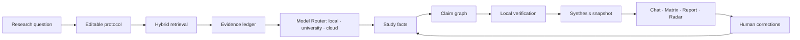

# نقشه‌راه پیشنهادی LitForge برای پژوهش هوشمند محلی

**تاریخ:** ۱۷ اکتبر ۲۰۲۶  
**وضعیت:** پیشنهاد محصول و معماری؛ بدون تغییر در کد  
**هدف:** تبدیل LitForge از ابزار کشف و آماده‌سازی مقاله به یک محیط پژوهش شواهدمحور که زمان جست‌وجو، غربالگری، خواندن، مقایسه و نگارش مرور ادبیات را به‌طور محسوس کم کند.

## جمع‌بندی کوتاه

LitForge در وضعیت فعلی پایه‌ای قوی و غیرمعمول دارد: کتابخانهٔ محلی مشترک، پروژه‌های مستقل، ورود PDF و شناسه‌های علمی، کشف مقاله از چند منبع، زنجیرهٔ استناد، رتبه‌بندی، غربالگری عنوان و چکیده با Ollama، استخراج ساختاریافته و صفحه‌دار PDF، تشخیص شکل/جدول/معادله، جست‌وجوی FTS5 و خروجی Markdown. این یعنی سخت‌ترین پیش‌نیاز یک دستیار پژوهشی قابل اعتماد، یعنی **متن ساختاریافته همراه با منشأ دقیق**، تا حد زیادی فراهم است.

فاصلهٔ اصلی میان وضعیت فعلی و محصول تحول‌آفرین، «تحلیل شواهدمحور» است. مدل محلی اکنون عمدتاً برای غربالگری و بازنویسی صفحات دشوار استفاده می‌شود؛ هنوز لایه‌ای عمومی برای پرسش از کتابخانه، استخراج واقعیت‌های قابل مقایسه، ساخت نقشهٔ ادعاها، تشخیص تعارض، ممیزی پاسخ و به‌روزرسانی مرور ادبیات وجود ندارد.

پیشنهاد محوری این سند ساختن **LitForge Evidence OS** است: هر خروجی مدل باید از واحدهای کوچک شواهد ساخته شود و هر گزارهٔ factual یا به صفحه/بخش/جدول/شکل وصل باشد یا صریحاً «استنباط» و «نیازمند بررسی» نام‌گذاری شود. قابلیت‌های خیره‌کننده باید روی این ستون فقرات سوار شوند، نه روی یک چت‌بات عمومی.

مدل اجرایی پیشنهادی **local-first و cloud-optional** است. پردازش PDF، indexing، retrieval و کارهای پرتعداد روی رایانهٔ کاربر انجام می‌شوند؛ مدل بزرگ محلی، دانشگاهی یا ابری فقط برای taskهایی مانند synthesis چندمقاله‌ای، تحلیل تعارض و ممیزی دشوار فراخوانی می‌شود. هیچ PDF کاملی به‌صورت پیش‌فرض ارسال نمی‌شود و مدل راه‌دور فقط بستهٔ کوچک و قابل مشاهده‌ای از شواهد منتخب را دریافت می‌کند.

## قابلیت‌های موجود که می‌توان روی آن‌ها ساخت

| حوزه | وضعیت فعلی | ارزش برای مرحلهٔ بعد |
|---|---|---|
| کتابخانه و پروژه | ذخیرهٔ محلی، deduplication، پروژه‌های مستقل و کش مشترک | تحلیل یک مقاله یک بار انجام و در چند پروژه بازاستفاده می‌شود |
| کشف مقاله | OpenAlex، Crossref، arXiv، citation chaining، import از فهرست منابع | ورودی مناسب برای مرور زنده و کشف شکاف‌ها |
| رتبه‌بندی | ارتباط موضوعی، اهمیت و دلیل کشف | نقطهٔ شروع خوب برای صف مطالعه و active learning |
| غربالگری | مدل محلی با خروجی JSON، سه تصمیم include/exclude/uncertain، cache و resume | زیرساخت آماده برای غربالگری تمام‌متن و یادگیری از تصمیم کاربر |
| PDF | PyMuPDF، Docling اختیاری، کیفیت‌سنجی، صفحه و bbox، شکل/جدول/معادله | امکان ساخت پاسخ‌های قابل ممیزی و لینک مستقیم به شاهد |
| مدل دیداری | بازنویسی انتخابی صفحات دشوار با Ollama و کنترل تطابق متن | قابلیت تحلیل هدفمند شکل، جدول و معادله بدون خواندن تصویری همهٔ صفحات |
| بازیابی | chunkهای بخش‌محور و SQLite FTS5 با محدودیت نتیجه برای هر مقاله | پایهٔ RAG محلی؛ نیازمند بازیابی ترکیبی و ارزیابی retrieval |
| خروجی | Markdown مناسب Obsidian همراه با دارایی‌های محلی | مسیر طبیعی برای گزارش، citation card و synthesis قابل نسخه‌بندی |
| رابط | CLI و وب محلی با jobهای پس‌زمینه | امکان افزودن workflowهای پژوهشی بدون وابستگی ابری |

اسناد فعلی نیز غربالگری تمام‌متن و تحلیل عمیق را پیش‌بینی کرده‌اند. این نقشه‌راه آن طرح را جایگزین نمی‌کند؛ آن را به یک محصول claim-centric، تعاملی و قابل ارزیابی گسترش می‌دهد.

## سه جهت ممکن برای محصول

### مسیر A: چت روی کتابخانه

یک رابط سؤال و جواب روی chunkهای بازیابی‌شده، با citation. سریع‌ترین مسیر برای نمایش ارزش است، اما به‌تنهایی به‌راحتی به «یک RAG دیگر» تبدیل می‌شود، مقایسهٔ نظام‌مند تولید نمی‌کند و اعتماد پژوهشگر را در پرسش‌های پیچیده حفظ نمی‌کند.

### مسیر B: سیستم‌عامل شواهد — پیشنهاد اصلی

واحد مرکزی محصول «گفت‌وگو» نیست؛ `evidence span`، `fact`، `claim`، `relationship` و `synthesis snapshot` است. چت، جدول مقایسه، گزارش، نقشهٔ تعارض و مرور زنده همگی نماهای متفاوت همین داده‌اند. این مسیر بیشترین تناسب را با معماری فعلی LitForge دارد و مزیت دفاع‌پذیر آن را می‌سازد.

### مسیر C: پژوهشگر خودکار چندعاملی

چند نقش مدل‌محور، مانند جست‌وجوگر، تحلیل‌گر، منتقد و نویسنده، کل مرور را خودکار انجام دهند. نمایش آن جذاب است، ولی پیش از ساخت ledger شواهد و ارزیابی قابل اعتماد، هزینهٔ محاسباتی و ریسک خطای مرکب بالایی دارد. این مسیر باید بعد از مسیر B و فقط برای workflowهای محدود ساخته شود.

**انتخاب پیشنهادی:** مسیر B، با یک تجربهٔ چت شواهدمحور به‌عنوان اولین سطح رابط؛ سپس اتوماسیون‌های محدود و قابل ممیزی از مسیر C.

## قابلیت‌های درخشان پیشنهادی

### ۱. Evidence Lens — پاسخ با قابلیت بازبینی در یک کلیک

پژوهشگر یک سؤال می‌پرسد و پاسخ به‌صورت چند «کارت ادعا» نمایش داده می‌شود. هر کارت شامل گزاره، درجهٔ اطمینان، نوع آن (`reported fact`، `model interpretation` یا `unsupported`)، مقالات مؤید/مخالف و لینک مستقیم به صفحه و highlight شاهد است.

ویژگی متمایز، حالت **Audit** است: با یک کلیک فقط جمله‌هایی دیده می‌شوند که شاهد ضعیف، تک‌منبعی، متعارض یا غیرمستقیم دارند. مدل دوم یا یک pass انتقادی محلی بررسی می‌کند آیا شاهد واقعاً ادعا را پشتیبانی می‌کند؛ مدل اجازه ندارد citation تازه‌ای خارج از شناسه‌های بازیابی‌شده بسازد.

**صرفه‌جویی مورد انتظار:** حذف رفت‌وبرگشت مکرر میان پاسخ، PDF و جست‌وجوی دستی؛ رسیدن از سؤال به مجموعهٔ شواهد قابل استفاده در چند دقیقه.

### ۲. Study Matrix — جدول مقایسه‌ای که خودش ساخته می‌شود

کاربر سؤال پژوهشی را می‌دهد و LitForge بر اساس آن schema مناسب می‌سازد؛ برای مثال جمعیت، حجم نمونه، dataset، preprocessing، مدل، پارامترها، baseline، metric، مقدار نتیجه، uncertainty، محدودیت و دسترسی کد. سپس هر مقاله به یک ردیف تبدیل می‌شود و **هر سلول** citation مستقل دارد.

کاربر می‌تواند ستون جدید را با زبان طبیعی تعریف کند: «نوع prior و روش validation را هم اضافه کن». سیستم فقط همان فیلد را روی مقالات موجود استخراج می‌کند، نتیجه را cache می‌کند و میان `not reported`، `not found` و `not applicable` فرق می‌گذارد.

این قابلیت باید export به Markdown/CSV/JSON و نمای side-by-side داشته باشد. اختلاف واحد، تعریف metric یا جمعیت به‌جای ادغام خام، با هشدار نمایش داده می‌شود.

**اثر:** کاری که معمولاً ساعت‌ها یا روزها استخراج دستی می‌خواهد به یک جدول اولیهٔ قابل ممیزی تبدیل می‌شود.

### ۳. Claim Graph — نقشهٔ اجماع، تعارض و زنجیرهٔ شواهد

LitForge ادعاهای مشابه را خوشه‌بندی می‌کند و رابطه‌های `supports`، `contradicts`، `qualifies`، `replicates` و `uses` را می‌سازد. کاربر می‌تواند ببیند:

- کدام نتیجه فقط در یک مقاله گزارش شده است؛
- کدام ادعا چند بار و با چه روش‌هایی تکرار شده؛
- تعارض احتمالاً ناشی از dataset، preprocessing، تعریف outcome یا طراحی مطالعه است؛
- یک ادعا از کدام مقاله آغاز و در مقالات بعدی چگونه نقل شده است.

قدرت این قابلیت در جداکردن **محبوبیت استنادی** از **قدرت شواهد** است. مدل علت تعارض را به‌عنوان فرضیه پیشنهاد می‌کند و هرگز آن را بدون شاهد به‌عنوان علت قطعی ثبت نمی‌کند.

**اثر:** پژوهشگر به‌جای خواندن خطی ده‌ها مقاله، landscape استدلالی حوزه را می‌بیند.

### ۴. Review Autopilot — پروتکل تا shortlist، با انسان در حلقه

از یک پرسش خام، مدل محلی یک پروتکل مرور قابل ویرایش می‌سازد: صورت‌بندی سؤال، مترادف‌ها، queryها، معیارهای ورود/خروج، فیلدهای استخراج و سیاست برخورد با موارد مبهم. پیش از اجرا، diff قابل مرور نمایش داده می‌شود.

پس از چند تصمیم دستی، active learning مقاله‌هایی را جلو می‌آورد که بیشترین اطلاعات را برای اصلاح مرز include/exclude دارند. این سیستم نباید تصمیم کاربر را تقلید کورکورانه کند؛ موارد با disagreement مدل، پوشش کم و شباهت نزدیک به مرز را به صف بررسی می‌فرستد.

یک نمای PRISMA-like، تاریخچهٔ queryها، دلیل حذف و نسخهٔ معیارها را خودکار نگه می‌دارد.

**اثر:** کم‌شدن چشمگیر مرور موارد واضح، با تمرکز زمان پژوهشگر روی موارد مرزی و پرریسک.

### ۵. Living Review Radar — مرور ادبیات زنده

هر پروژه یک snapshot نسخه‌دار از جست‌وجو و synthesis دارد. اجرای بعدی فقط آثار تازه یا تغییرکرده را می‌یابد، آن‌ها را با همان rubric غربال می‌کند و یک گزارش delta می‌سازد:

- چه مقاله‌های مهمی اضافه شدند؛
- کدام نتیجهٔ قبلی تقویت یا تضعیف شد؛
- کدام سلول‌های Study Matrix تغییر کردند؛
- آیا نتیجهٔ کلی مرور نیاز به بازنویسی دارد؛
- کدام ادعاها هنوز بدون replication مانده‌اند.

اعلان باید بر پایهٔ تغییر معنی‌دار باشد، نه صرفاً تعداد مقالهٔ جدید. اجرای زمان‌بندی‌شده اختیاری است و تمام وضعیت در سیستم محلی می‌ماند.

**اثر:** به‌روزرسانی مرور ادبیات از یک پروژهٔ مجدد به یک کار incremental تبدیل می‌شود.

### ۶. Figure/Table/Equation Intelligence — خواندن آنچه در متن نیست

مدل دیداری فقط برای دارایی‌هایی فراخوانی می‌شود که retrieval آن‌ها را برای سؤال لازم تشخیص داده است. قابلیت‌های هدف:

- تبدیل جدول‌های منتخب به سلول‌های ساختاریافته با واحد و footnote؛
- استخراج مقدار تقریبی از نمودار همراه با برچسب «digitized estimate»؛
- توضیح محور، legend، گروه کنترل و error bar؛
- نرمال‌سازی نمادهای معادلات و ساخت glossary میان مقالات؛
- مقایسهٔ دو formulation ریاضی و نشان‌دادن تفاوت فرض‌ها.

هر خروجی کنار crop اصلی نمایش داده می‌شود. مقادیر خوانده‌شده از تصویر هیچ‌گاه هم‌ارز دادهٔ عددی گزارش‌شده در متن تلقی نمی‌شوند.

**اثر:** بخش بزرگی از دانش قفل‌شده در شکل‌ها و جدول‌ها قابل جست‌وجو و مقایسه می‌شود.

### ۷. Reproducibility Radar — از مقاله تا بستهٔ بازتولید

برای هر مطالعه، سیستم یک کارت بازتولید می‌سازد: داده، کد، نسخه‌ها، seed، preprocessing، hyperparameter، سخت‌افزار، split، metric و موارد گزارش‌نشده. لینک‌های repository و dataset استخراج می‌شوند، اما هیچ کدی خودکار اجرا نمی‌شود.

خروجی می‌تواند یک checklist و `reproduction brief` تولید کند: چه داده‌ای لازم است، چه مرحله‌هایی روشن نیست، کدام پارامترها باید از نویسنده پرسیده شود و برآورد تقریبی منابع محاسباتی چیست.

**اثر:** ارزیابی reproducibility از یادداشت پراکنده به workflow استاندارد تبدیل می‌شود.

### ۸. Gap & Experiment Designer — پیشنهاد شکاف و آزمایش بعدی

مدل فقط از روی Claim Graph و Study Matrix شکاف‌های کاندید را پیشنهاد می‌کند: جمعیت بررسی‌نشده، baseline غایب، نتیجهٔ متعارض، پارامتر بدون sensitivity analysis یا ادعای بدون replication. سپس برای هر شکاف یک کارت می‌سازد:

- شواهدی که وجود شکاف را نشان می‌دهند؛
- چرا ممکن است مهم باشد؛
- کمینهٔ آزمایش یا تحلیل لازم برای بررسی؛
- داده، کنترل، outcome و failure mode پیشنهادی؛
- مواردی که مدل نمی‌داند.

این خروجی باید صریحاً «پیشنهاد پژوهشی» باشد، نه نتیجهٔ ادبیات.

**اثر:** فاصلهٔ میان مرور ادبیات و طراحی پروژهٔ بعدی کوتاه می‌شود، بدون پنهان‌کردن عدم‌قطعیت.

### ۹. Research Workspace Memory — حافظهٔ واقعی پروژه

LitForge تصمیم‌ها، واژگان، aliasها، تعریف metricها، یادداشت‌های پژوهشگر و اصلاحات مدل را به‌صورت نسخه‌دار نگه می‌دارد. مدل در هر جلسه لازم نیست کل پروژه را دوباره بخواند؛ یک `project brief` فشرده و ارجاع‌پذیر از سؤال‌ها، تصمیم‌ها، ادعاهای کلیدی و کارهای باز دریافت می‌کند.

وقتی پژوهشگر یک extraction را اصلاح می‌کند، اصلاح فقط به همان مقدار محدود نمی‌شود: سیستم موارد مشابه را برای بازبینی پیشنهاد می‌دهد، ولی بدون تأیید کاربر آن‌ها را تغییر نمی‌دهد.

**اثر:** حذف زمان بازسازی context و جلوگیری از فراموش‌شدن تصمیم‌های تحلیلی.

### ۱۰. Natural-Language Research Console — فرمان طبیعی با preview

کاربر می‌تواند بگوید: «مقاله‌های ۲۰۱۹ به بعد که EEG دارند و کد منتشر کرده‌اند جدا کن، روش inference را مقایسه کن و موارد متعارض را نشان بده». مدل این درخواست را به یک plan ساختاریافته شامل filter، retrieval، extraction و export تبدیل می‌کند و پیش از اجرا preview هزینه و دامنه می‌دهد.

این لایه نباید SQL یا shell آزاد تولید و اجرا کند. فقط از actionهای محدود، typed و قابل ثبت LitForge استفاده می‌کند.

**اثر:** قابلیت‌های پیچیده بدون حفظ‌کردن commandها و بدون ساختن رابط جدا برای هر ترکیب در دسترس می‌شوند.

### ۱۱. Hybrid Model Gateway — توان مدل بزرگ بدون نیاز به GPU بزرگ

LitForge باید بتواند علاوه بر Ollama به هر endpoint سازگار با OpenAI، یک سرور مدل دانشگاهی مانند vLLM و در صورت نیاز adapterهای اختصاصی وصل شود. این لایه provider-agnostic است؛ DeepSeek، Qwen، Kimi یا هر سرویس دیگر فقط یک profile پیکربندی هستند و منطق تحلیل به هیچ شرکت یا نام مدل خاصی وابسته نمی‌شود.

سه سیاست روشن در UI در دسترس باشند:

- **Local only:** هیچ محتوایی از دستگاه خارج نمی‌شود؛
- **Ask before cloud:** پیش از هر فراخوانی، provider، مدل، دادهٔ ارسالی و هزینهٔ تخمینی نمایش داده می‌شود؛
- **Hybrid:** Model Router با توجه به نوع task، حساسیت داده، کیفیت مورد نیاز و سقف هزینه مسیر را انتخاب می‌کند.

تقسیم کار پیشنهادی این است:

| task | مسیر پیش‌فرض |
|---|---|
| parsing، OCR، indexing و retrieval | محلی |
| embedding و غربالگری انبوه | محلی یا API ارزان batch |
| extraction ساده و ساخت Study Matrix اولیه | محلی یا cloud-fast |
| synthesis چندمقاله‌ای و تحلیل تعارض | cloud-reasoning یا سرور بزرگ دانشگاهی |
| Audit نهایی ادعا و citation | pass مستقل، ترجیحاً با مدلی متفاوت |
| unpublished paper یا یادداشت حساس | محلی، مگر با تأیید صریح |

مدل راه‌دور فقط `evidence packet` دریافت می‌کند: متن کوتاه شواهد، شناسه‌های غیرقابل جعل، نام بخش و شمارهٔ صفحه. پاسخ ساختاریافته باید فقط به همان evidence IDها ارجاع دهد. API key در environment یا keychain نگهداری می‌شود و هر فراخوانی با provider، model، token usage، هزینه، latency، hash ورودی و فهرست شواهد ارسالی ثبت می‌شود.

پیکربندی مفهومی:

```yaml
models:
  policy: ask_before_cloud
  local:
    provider: ollama
    model: qwen3:4b
  cloud_fast:
    provider: openai_compatible
    base_url_env: LITFORGE_FAST_BASE_URL
    api_key_env: LITFORGE_FAST_API_KEY
    model: configured-by-user
  cloud_reasoning:
    provider: openai_compatible
    base_url_env: LITFORGE_REASONING_BASE_URL
    api_key_env: LITFORGE_REASONING_API_KEY
    model: configured-by-user

privacy:
  allow_cloud: false
  send_full_pdf: false
  require_confirmation_for_sensitive_content: true

budget:
  max_per_run_usd: 2
  max_per_month_usd: 20
```

**اثر:** LitForge روی مک یا GPU دوازده‌گیگابایتی سریع و خصوصی باقی می‌ماند، ولی سقف کیفیت تحلیل آن به سخت‌افزار کاربر محدود نمی‌شود. بیشترین صرفه‌جویی از retrieval محلی و نفرستادن متن کامل مقاله حاصل می‌شود؛ ارزان‌بودن provider مزیت دوم است.

## ستون فقرات فنی مشترک

برای جلوگیری از ساخت featureهای جدا از هم، ابتدا شش جزء مشترک لازم است:

1. **Hybrid Model Gateway & Router:** رابط واحد برای Ollama، endpointهای OpenAI-compatible، سرور دانشگاهی و adapterهای اختصاصی؛ انتخاب مدل بر اساس task، حساسیت داده، کیفیت، context و budget؛ structured output، timeout، retry، cache و ثبت نسخهٔ provider/prompt/model. fallback به provider دیگر هرگز بدون سیاست صریح پروژه انجام نشود.
2. **Hybrid Retriever:** ادغام FTS5، embedding و سیگنال‌های metadata با diversification میان مقاله‌ها و sectionها. کیفیت آن با مجموعهٔ سؤال و شاهد برچسب‌خورده سنجیده شود.
3. **Evidence Ledger:** ذخیرهٔ immutable برای spanهای متن، cropها، سلول‌های جدول و provenance شامل paper، parse version، page، bbox و content hash.
4. **Claim Store:** ادعا، نوع ادعا، وضعیت، confidence توصیفی، رابطه با شواهد، رابطه با ادعاهای دیگر و تاریخچهٔ تأیید انسانی.
5. **Analysis Job Engine:** jobهای idempotent و resumable برای extraction، verification، synthesis و refresh؛ امکان pause/cancel و نمایش پیشرفت.
6. **Evaluation Harness:** golden questions، evidence labels، screening decisions و comparison tables برای سنجش retrieval، citation، extraction و hallucination پس از هر تغییر مدل یا prompt.

جریان دادهٔ هدف:



## مدل دادهٔ پیشنهادی در سطح مفهومی

این موجودیت‌ها بهتر است با migrationهای کوچک و مستقل اضافه شوند:

- `analysis_runs`: هدف، پروژه، task، provider، مدل، prompt، config، وضعیت و زمان؛
- `model_calls`: مدل، token usage، هزینه، latency، hash ورودی، evidence IDهای ارسال‌شده و نتیجه؛
- `evidence_spans`: منبع دقیق شاهد و hash محتوای آن؛
- `study_facts`: فیلد schema، مقدار typed، واحد، وضعیت و evidence؛
- `claims`: متن canonical، نوع، دامنه، وضعیت بررسی و منشأ؛
- `claim_evidence`: رابطهٔ support/contradict/qualify و قدرت رابطه؛
- `claim_relations`: مشابهت، تعارض، replication و dependency؛
- `synthesis_snapshots`: خروجی نسخه‌دار وابسته به مجموعهٔ claimها؛
- `human_reviews`: اصلاح، پذیرش، رد و دلیل؛
- `watch_runs`: اجرای incremental و delta نسبت به snapshot قبلی.

منبع حقیقت باید دادهٔ ساختاریافته باشد؛ Markdown یکی از خروجی‌های قابل حمل باقی بماند.

## ترتیب پیشنهادی توسعه

### فاز ۰ — معیار اعتماد و زیرساخت مشترک

**هدف:** هر feature بعدی قابل سنجش و قابل تکرار باشد.

- تبدیل adapter فعلی Ollama به Hybrid Model Gateway با interface عمومی و adapterهای `ollama` و `openai_compatible`؛
- افزودن Model Router با سه policy برابر `local_only`، `ask_before_cloud` و `hybrid`؛
- افزودن budget guard، cost preview، audit log و نگهداری key فقط در environment یا keychain؛
- تعریف evidence packet تا هیچ PDF کامل یا دادهٔ خارج از retrieval به‌صورت پیش‌فرض ارسال نشود؛
- افزودن schemaهای Evidence Ledger و Analysis Run؛
- ساخت benchmark کوچک ولی واقعی: ۳۰ سؤال، ۵۰ شاهد، ۱۰ جدول مقایسه و مجموعه‌ای از ادعاهای موافق/مخالف؛
- افزودن embedding و hybrid retrieval فقط اگر Recall@k را به‌طور معنی‌دار بهتر کند؛
- ثبت نسخهٔ parser، prompt، model و input hash برای تمام خروجی‌ها.

**خروجی قابل عرضه:** پاسخ retrieval شده با citation دقیق، بدون synthesis آزاد.

### فاز ۱ — محصول درخشان اولیه: Evidence Lens + Study Matrix

**هدف:** نخستین تجربه‌ای که پژوهشگر فوراً ارزش آن را حس کند.

- پرسش از کتابخانه با پاسخ sentence-level citation؛
- نمای evidence card و بازشدن PDF در صفحهٔ مربوط؛
- extraction schema قابل تعریف و جدول مقایسهٔ citation-per-cell؛
- export به Markdown و CSV؛
- pass ممیزی و صف «نیازمند بررسی»؛
- synthesis و Audit اختیاری با مدل بزرگ، همراه با preview داده و هزینه پیش از ارسال.

**شرط عبور:** هیچ گزارهٔ factual در گزارش نهایی بدون evidence یا برچسب صریح unsupported نباشد؛ خطای citation و extraction روی benchmark اندازه‌گیری و نمایش داده شود.

### فاز ۲ — Claim Graph + غربالگری تمام‌متن و active learning

**هدف:** کاهش زمان تصمیم‌گیری و آشکارکردن ساختار واقعی ادبیات.

- استخراج و canonicalization ادعاها؛
- خوشه‌بندی ادعاهای مشابه و تشخیص کاندیدای تعارض؛
- S2/S3 screening روی بخش‌های بازیابی‌شده؛
- صف active learning و disagreement؛
- تاریخچهٔ کامل دلیل و نسخهٔ تصمیم.

**شرط عبور:** false negative در shortlist روی مجموعهٔ برچسب‌خورده زیر آستانهٔ توافق‌شده بماند و هیچ exclude خودکاری بدون معیار صریح رخ ندهد.

### فاز ۳ — Living Review + Reproducibility Radar

**هدف:** تبدیل پروژهٔ یک‌باره به حافظهٔ زندهٔ پژوهش.

- snapshot و delta برای جست‌وجو، matrix، claim و synthesis؛
- refresh دستی و سپس زمان‌بندی اختیاری؛
- کارت reproducibility و بستهٔ سؤال‌های باز؛
- اعلان فقط برای تغییرهای معنادار.

### فاز ۴ — Figure Intelligence + Gap Designer

**هدف:** دسترسی به شواهد دشوار و کمک به طراحی پژوهش بعدی.

- پردازش on-demand شکل/جدول/معادله؛
- ارزیابی جداگانهٔ fidelity عدد، واحد، legend و symbol؛
- gap card و experiment brief با provenance؛
- بررسی انسانی اجباری پیش از export به‌عنوان نتیجه یا پیشنهاد رسمی.

### فاز ۵ — اتوماسیون محدود و Research Console

**هدف:** ترکیب workflowها با زبان طبیعی و حفظ کنترل کاربر.

- action registry محدود و typed؛
- preview دامنه، زمان تقریبی و مدل مورد استفاده؛
- اجرای planهای چندمرحله‌ای با checkpoint؛
- قالب‌های workflow برای systematic review، scoping review و deep dive.

### نامزد بررسی — گراف دانش بین مقاله‌ها

**وضعیت:** در حال بررسی؛ هنوز تصمیم به ساخت گرفته نشده. ایده از مقایسه با RAG-Anything (HKUDS) آمده که روی LightRAG یک گراف از موجودیت‌ها و رابطه‌های بین متن، شکل و جدول می‌سازد.

**ایده:** فراتر از Claim Graph، موجودیت‌های پژوهشی مثل روش، dataset، metric، مدل و سؤال پژوهشی از مقاله‌ها استخراج شوند و بین مقاله‌ها به هم وصل شوند؛ مثلاً «کدام روش‌ها روی کدام dataset و با کدام metric سنجیده شده‌اند».

**پرسش‌هایی که بررسی باید جواب دهد:**

- آیا Claim Graph فعلی و Study Matrix همین نیاز را پوشش نمی‌دهند؟ چه پرسش واقعی کاربر فقط با گراف موجودیت جواب می‌گیرد؟
- هر گره و یال چطور به evidence span ثبت‌شده برگردد تا provenance حفظ شود؟ یال بدون شاهد پذیرفته نیست.
- ادغام نام‌های هم‌معنا مثل NPE و neural posterior estimation چطور قطعی و قابل بازبینی انجام شود؟
- هزینهٔ استخراج روی مدل محلی برای ۱۰۰ و ۱۰۰۰ مقاله چقدر است و آیا on-demand کافی است؟
- ذخیره در همان SQLite بماند؛ کتابخانهٔ جداگانه با storage مستقل پذیرفته نیست.

**شرط ورود:** طبق بخش «چیزهایی که فعلاً نباید ساخته شوند»، فقط وقتی شروع شود که Claim Graph روی چند پروژهٔ واقعی ارزش خود را نشان داده باشد و یک spec کوچک با معیار پذیرش نوشته شده باشد.

### فاز ۶ — Writing Studio: نگارش LaTeX با کمک مدل زبانی

**تصمیم:** نگارش در VS Code می‌ماند. آنچه ساخته می‌شود W0 و یک **سرور MCP برای LitForge** است: شواهد، ارجاع‌ها و بررسی‌های LitForge به‌صورت ابزار در اختیار دستیارهای هوش مصنوعی VS Code (Claude Code، Copilot Chat، Continue) قرار می‌گیرد و ویرایش، کامپایل و پیش‌نمایش با LaTeX Workshop انجام می‌شود. ابزارها: جست‌وجوی شواهد، پیشنهاد ارجاع با نقل‌قول، بررسی پشتیبانی جمله، بررسی عدد و ارجاع ساختگی در ویرایش پیشنهادی، اطلاعات مقاله، ماتریس و ادعاها، و خروجی BibTeX؛ افزودن به فایل `.bib` فقط با اجازهٔ صریح. ویرایشگر داخلی که در ادامه آمده **طرحی برای آینده است و فعلاً اجرا نمی‌شود.**


**هدف:** نوشتن مقاله داخل LitForge، شبیه Overleaf ولی محلی، با ارجاع‌هایی که به شواهد تأییدشده وصل می‌مانند و پیشنهادهای مدل زبانی که همیشه به‌صورت diff قابل پذیرش یا رد نمایش داده می‌شوند.

- **W0 — پایه:** کلید ارجاع پایدار برای هر مقاله، خروجی `references.bib` و خروجی `.tex` برای گزارش، پاسخ و ماتریس؛ فقط ارجاع‌هایی که نقل‌قولشان تأیید شده است.
- **W1 — ویرایشگر و کامپایل:** ویرایشگر CodeMirror، کامپایل محلی با Tectonic به‌عنوان ابزار اختیاری، پیش‌نمایش PDF با پرش SyncTeX، تاریخچهٔ نسخه‌ها با git، ورود و خروج ZIP سازگار با Overleaf.
- **W2 — ارجاع آگاه از شواهد:** جست‌وجو و درج `\cite` از کتابخانه و دفتر شواهد، نمایش نقل‌قول پشت هر ارجاع، بررسی ارجاع‌ها و «آیا این جمله پشتیبانی می‌شود؟».
- **W3 — کمک مدل زبانی:** بهبود متن، کوتاه‌کردن، دستور زبان، ترجمهٔ فارسی و انگلیسی، رفع خطای LaTeX، پیشنهاد ارجاع و نوشتن پیش‌نویس از شواهد انتخاب‌شده؛ هر کار یک task جدا در gateway، فقط متن انتخاب‌شده ارسال می‌شود، ابری فقط با تأیید، و عدد یا ارجاعی که در متن یا شواهد نباشد علامت می‌خورد.
- **W4 — بعداً:** همگام‌سازی git با Overleaf یا هر میزبان git؛ ویرایش هم‌زمان چندنفره خارج از دامنه است.
- **فارسی الزامی است:** سندها با XeLaTeX و `xepersian` کامپایل می‌شوند و یک الگوی فارسی و یک الگوی فارسی‌ـ‌انگلیسی آزموده‌شده همراه برنامه می‌آید؛ پیش از W1 بررسی می‌شود که Tectonic از عهدهٔ `xepersian` برمی‌آید یا XeLaTeX سیستم لازم است.
- **هم‌تراز با هوش مصنوعی Overleaf:** دستیار گفت‌وگو با سند، توضیح و رفع خطای کامپایل، پیشنهاد زبانی، بازنویسی، تولید عنوان و چکیده، تبدیل زبان طبیعی به LaTeX، تولید معادله و جدول از متن یا تصویر، مترادف، بررسی و پیشنهاد ارجاع و تکمیل جمله؛ با این تفاوت که پیش‌فرض مدل محلی است و ارجاع‌ها و جدول‌ها از کتابخانه و شواهد تأییدشده می‌آیند.

- **ایده‌های غیرهوش‌مصنوعی از Overleaf:** الگوهای آماده (از جمله پایان‌نامهٔ فارسی)، تکمیل خودکار `\cite` و `\ref`، نمای ساختار سند، انتخاب کامپایلر و فایل اصلی، فهرست خطاها، تاریخچه با نسخه‌های نام‌دار، شمارش واژه، غلط‌یاب فارسی و انگلیسی؛ ویرایش هم‌زمان چندنفره و ارسال به مجله خارج از دامنه است.
- **نسخهٔ اول پیشنهادی:** W0، آزمایش `xepersian` با Tectonic، W1 سبک (ویرایشگر، کامپایل، پیش‌نمایش، خطاها، نسخه‌ها، الگوها) و فقط سه کار مدل زبانی: رفع خطا، بازنویسی متن انتخاب‌شده، پیشنهاد ارجاع. کمتر از نصف کل کار است و بقیه فقط اگر این نسخه واقعاً استفاده شد.
- **جایگزین ارزان‌تر:** نوشتن در همان ویرایشگر همیشگی (VS Code، TeXstudio یا Overleaf) و LitForge فقط به‌عنوان همراه برای ارجاع، بررسی ارجاع و کارهای مدل زبانی روی فایل `.tex`.

طرح کامل: [Writing Studio design](superpowers/specs/2026-10-18-latex-writing-studio-design.md).

هر فاز باید spec و implementation plan مستقل داشته باشد. شکستن این نقشه‌راه به چند پروژه، هم ریسک را کم می‌کند و هم اجازه می‌دهد هر فاز یک محصول قابل استفاده تحویل دهد.

## اولویت‌بندی

| قابلیت | اثر روی زمان | اثر روی کیفیت | جذابیت نمایشی | تلاش نسبی | اولویت |
|---|---:|---:|---:|---:|---:|
| Evidence Lens | بسیار زیاد | بسیار زیاد | زیاد | متوسط | P0 |
| Study Matrix | بسیار زیاد | بسیار زیاد | بسیار زیاد | متوسط | P0 |
| Hybrid Model Gateway + Router + Evaluation | غیرمستقیم ولی بنیادی | حیاتی | متوسط | متوسط | P0 |
| Full-text screening + active learning | بسیار زیاد | زیاد | متوسط | متوسط | P1 |
| Claim Graph | زیاد | بسیار زیاد | بسیار زیاد | زیاد | P1 |
| Living Review Radar | زیاد | زیاد | زیاد | متوسط | P1 |
| Reproducibility Radar | متوسط | زیاد | زیاد | متوسط | P2 |
| Figure/Table/Equation Intelligence | زیاد در حوزه‌های خاص | زیاد | بسیار زیاد | زیاد | P2 |
| Gap & Experiment Designer | متوسط | بالقوه زیاد | بسیار زیاد | زیاد و پرریسک | P3 |
| Natural-Language Console | متوسط | متوسط | زیاد | متوسط | پس از تثبیت actionها |
| Writing Studio: W0 + سرور MCP | زیاد در مرحلهٔ نگارش | زیاد | زیاد | کم تا متوسط | P1 |
| Writing Studio: ویرایشگر داخلی | زیاد | زیاد | بسیار زیاد | زیاد | آینده، برنامه‌ریزی‌نشده |

## چیزهایی که فعلاً نباید ساخته شوند

- چت عمومی بدون citation اجباری؛
- agent خودمختار با دسترسی آزاد به shell، SQL یا شبکه؛
- خلاصه‌سازی کل PDF بدون retrieval و provenance؛
- meta-analysis عددی خودکار پیش از حل واحدها، تعریف outcome و استخراج دادهٔ معتبر؛
- knowledge graph عظیم از تمام entityها پیش از اثبات ارزش Claim Graph کوچک؛
- انتخاب مدل صرفاً بر اساس اندازه یا benchmark عمومی؛
- hard-code کردن یک provider یا نام مدل در منطق تحلیل؛
- ارسال PDF کامل یا کل کتابخانه به cloud وقتی evidence packet کافی است؛
- fallback خودکار از مدل محلی به cloud بدون policy و رضایت قابل ثبت؛
- پردازش vision همهٔ صفحات و شکل‌ها؛
- نمرهٔ «کیفیت مقاله» واحد و مبهم.

## معیارهای موفقیت

اعداد زیر هدف اولیه‌اند و باید روی benchmark واقعی تنظیم شوند:

- دست‌کم ۹۹٪ citationهای تولیدشده به شاهد ذخیره‌شده و نسخهٔ درست PDF resolve شوند؛
- ۱۰۰٪ جمله‌های factual خروجی یا evidence داشته باشند یا برچسب unsupported/interpretation؛
- Recall@10 بازیابی روی سؤال‌های benchmark پیش از عرضهٔ Q&A اندازه‌گیری شود؛
- نرخ false negative غربالگری روی مجموعهٔ طلایی، معیار اصلی باشد و از نرخ حذف مهم‌تر تلقی شود؛
- extraction جدول مقایسه برای مقدار، واحد و `not reported` جداگانه سنجیده شود؛
- زمان ساخت اولین matrix و زمان refresh incremental ثبت و با workflow دستی مقایسه شود؛
- درصد اصلاح انسانی، disagreement مدل‌ها و تغییر خروجی پس از تعویض مدل در UI قابل مشاهده باشد؛
- کیفیت، latency و هزینهٔ providerها روی taskهای یکسان مقایسه شود و routing بر اساس benchmark خود LitForge تنظیم شود؛
- سقف هزینهٔ هر run پیش از شروع enforce شود و هزینهٔ واقعی از سقف عبور نکند؛
- هر synthesis با snapshot داده، نسخهٔ مدل و prompt بازتولیدپذیر باشد.

آزمایش محصول باید زمان واقعی پژوهشگر را هم بسنجد: برای یک مجموعهٔ ثابت، انجام سؤال، shortlist، جدول مقایسه و یافتن تعارض به‌صورت دستی و با LitForge مقایسه شود. هدف خوب برای نسخهٔ اول، کاهش حداقل ۵۰٪ زمان این چهار کار بدون افت recall یا citation accuracy است؛ این عدد باید نتیجهٔ آزمایش باشد، نه ادعای بازاریابی.

## ریسک‌ها و کنترل‌ها

| ریسک | کنترل پیشنهادی |
|---|---|
| hallucination و citation ظاهراً معتبر | citation فقط از evidence IDهای موجود؛ verifier مستقل؛ برچسب unsupported |
| ضعف مدل محلی در استدلال طولانی | تجزیهٔ task، context کوچک، schema، passهای مستقل و امکان model routing |
| خطای retrieval که مدل قادر به جبران آن نیست | benchmark، hybrid retrieval، coverage view و امکان «شاهد کافی پیدا نشد» |
| prompt injection در متن مقاله | سند همیشه دادهٔ غیرقابل اعتماد است؛ action یا instruction از متن اجرا نشود |
| ادغام نتایج ناسازگار | حفظ واحد، cohort، metric definition و provenance؛ عدم ادغام خودکار |
| هزینهٔ GPU و زمان زیاد | cache محتوایی، پردازش افزایشی، vision انتخابی و queue تک‌مدلی |
| خروج دادهٔ حساس به provider ابری | local-only پیش‌فرض، evidence preview، تأیید صریح و ممنوعیت ارسال PDF کامل |
| تغییر قیمت، مدل یا availability سرویس | adapter عمومی، model profile نسخه‌دار، benchmark دوره‌ای و نبود fallback پنهان |
| مصرف ناخواستهٔ اعتبار API | cost estimate، سقف per-run/per-month، توقف سخت و گزارش token واقعی |
| اعتماد بیش از حد کاربر به نمودارها | نمایش کیفیت extraction، تعداد منبع و دسترسی سریع به اصل شاهد |
| تغییر خروجی با مدل جدید | snapshot immutable، versioning و diff پیش از جایگزینی |

## پیشنهاد نسخهٔ اول قابل عرضه

اگر فقط یک بستهٔ قابلیت انتخاب شود، این ترکیب بیشترین بازده را دارد:

1. **Ask Library** با پاسخ کوتاه، citation جمله‌ای و لینک صفحه؛
2. **Evidence Cards** با تب‌های Support، Contradiction و Needs Review؛
3. **Study Matrix** با پنج تا ده ستون قابل تعریف و citation برای هر سلول؛
4. **Audit Pass** برای بررسی entailment و شواهد ناقص؛
5. **Model Policy & Cost Preview** با حالت‌های Local only و Ask before cloud؛
6. **Export Research Brief** شامل سؤال، روش جست‌وجو، جدول، یافته‌ها، تعارض‌ها و شکاف‌ها.

این نسخه هم یک demo قدرتمند است، هم ارزش روزمره دارد و هم زیرساخت Claim Graph و Living Review را می‌سازد. پیشنهاد می‌شود Claim Graph کامل، agentهای چندنقشی و Gap Designer تا زمانی که این نسخه روی benchmark و چند پروژهٔ واقعی قابل اعتماد نشده، آغاز نشوند.

## گام بعدی پیشنهادی

پس از بازبینی این سند، فقط فاز ۰ و فاز ۱ به یک spec دقیق شکسته شوند. آن spec باید persona اصلی، workflow نمونه، schema داده، mock رابط، benchmark، آستانه‌های پذیرش و migrationهای لازم را مشخص کند. سپس برای همان محدوده implementation plan جداگانه نوشته شود؛ سایر فازها در حد roadmap باقی بمانند تا نتایج واقعی فاز اول جهت آن‌ها را تعیین کند.

## مبنای بررسی

- [README](../README.md)
- [راهنمای فعلی](guide.md)
- [طرح معماری تحلیل ادبیات](literature_analysis_architecture_plan.md)
- [رابط مدل محلی](../src/litforge/screening/llm.py)
- [غربالگری](../src/litforge/screening/run.py)
- [جست‌وجوی FTS5](../src/litforge/indexing/fts.py)
- [پردازش دیداری](../src/litforge/parsing/vision.py)
- [CLI](../src/litforge/cli.py)
- [سرور محلی](../src/litforge/ui/server.py)
- [سازگاری API رسمی DeepSeek](https://api-docs.deepseek.com/guides/codex)
- [endpointهای رسمی Alibaba Model Studio](https://www.alibabacloud.com/help/en/model-studio/regions/)
- [قیمت‌گذاری رسمی مدل‌های Qwen](https://www.alibabacloud.com/help/en/model-studio/model-pricing)
- [معرفی رسمی Kimi API](https://www.kimi.ai/help/kimi-api/api-overview)

